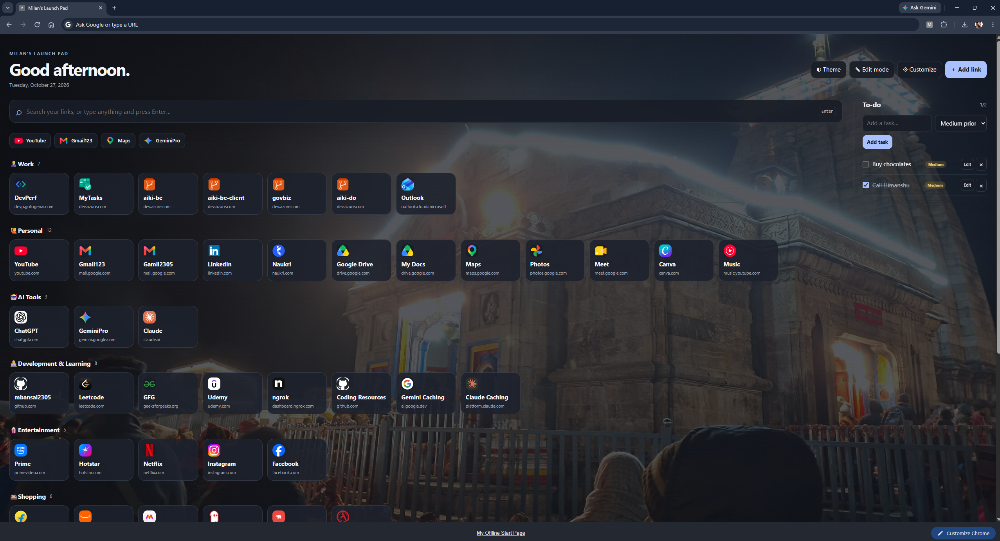

# Offline Chrome New Tab Launchpad

This is a Chrome Manifest V3 extension. JavaScript is in `app.js` (not inline), so it complies with Chrome extension Content Security Policy.

## Preview

## Install / update

1. Download and extract this ZIP to a permanent folder.
2. Open `chrome://extensions` in Chrome.
3. Enable **Developer mode**.
4. Click **Load unpacked** and select the `custom-chrome-launchpad-main` folder that contains `manifest.json`.
5. Open a new tab.

## Features

- Add, edit, delete and search shortcuts.
- Move shortcuts into a hidden section at the bottom of the page, or add them there directly.
- Category grouping; rename and move categories.
- Drag-and-drop link reordering while Edit mode is enabled; drag a link into another category grid to move it.
- Favorites row (star/unstar links).
- Right-side editable to-do list with checkboxes and color-coded low, medium, and high priorities; tasks are saved locally and included in backups.
- Website favicon with emoji fallback; emoji-only or custom image path mode.
- Light/dark theme.
- Custom page title, background image/path, overlay, tile sizing, favorite row count.
- Keyboard shortcuts: `/` focus search, `A` add link, `E` toggle edit mode, `T` toggle theme, `Esc` close dialogs.
- JSON export/import backup.

## Offline behavior

The dashboard, saved links, to-do items, layout settings, and emoji fallbacks work offline. Website favicon retrieval and the websites themselves may require internet. For fully offline images, keep image files inside this extension folder and use relative paths, e.g. `logos/github.png`. Background images can also use a relative path `bg/mountains.png`.

Link data is stored in this Chrome profile's local storage using the key as (`offlineStartPage.links.v1`) to attempt to preserve your previous saved links. Export a backup before replacing extensions or clearing Chrome data.
